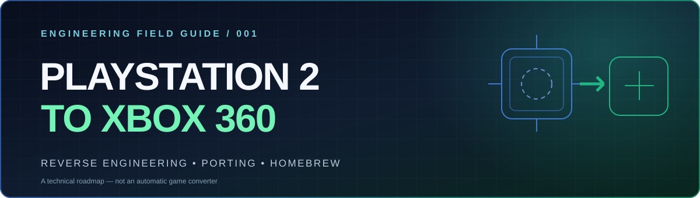
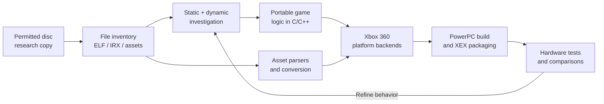

<div align="center">
  

  <h3>Understand the original. Rebuild the systems. Target new hardware.</h3>

  <p>
    <a href="docs/00-start-here.md"></a>
    <a href="docs/10-roadmap.md"></a>
    <a href="docs/11-legal.md"></a>
  </p>

  <p>
    
    
    
    <a href="LICENSE"></a>
  </p>

  <p><a href="#overview">Overview</a> • <a href="#the-engineering-pipeline">Pipeline</a> • <a href="#documentation">Documentation</a> • <a href="#quick-start">Quick start</a> • <a href="#project-status">Status</a></p>
</div>

---

> [!IMPORTANT]
> **An educational guide, not a working PS2 emulator or one-click game converter.** This repository does not include game ISOs, copyrighted assets, BIOS files, console keys, proprietary SDKs, or a finished game port. The steps describe engineering research and must be adapted to each individual title.

## Overview

**Playstation2forXbox360** is a detailed, English-language field guide for studying PlayStation 2 software and understanding how a game could be **reconstructed as a native Xbox 360 homebrew application**. It covers PS2 hardware, disc formats, MIPS reverse engineering, C/C++ reimplementation, asset pipelines, Xbox 360 hardware, graphics and audio backends, XSDK, XEX packaging, debugging, and realistic development milestones.

There is **no direct ISO → XEX conversion**. Original PS2 programs run MIPS code and depend on the Emotion Engine, Graphics Synthesizer, IOP and SPU2; Xbox 360 uses a PowerPC CPU, Xenos GPU and different system APIs.

### Choose the correct approach

| Approach | What it means | Result |
|:--|:--|:--|
| **Emulation** | Recreate enough PS2 hardware/software to run the original program. | Emulator + original game; **not** a native port. |
| **Source port** | Adapt lawfully available code and replace platform-specific systems. | Recompiled Xbox 360 program. |
| **Reverse-engineered port** | Observe and reconstruct game behavior, data formats and engine systems. | Newly developed native implementation. |
| **Static recompilation research** | Translate executable code while handling runtime and hardware dependencies. | Experimental route; **not** a universal automatic solution. |

## The engineering pipeline



> **Guiding rule:** Keep game logic independent of graphics, audio, controller, asset, storage and platform interfaces. Build and validate one subsystem at a time.

## Documentation

| # | Chapter | Focus |
|:--:|:--|:--|
| 00 | [Start here](docs/00-start-here.md) | Scope, prerequisites and first experiment |
| 01 | [PS2 hardware architecture](docs/01-ps2-architecture.md) | EE, VU0/VU1, GS, IOP, SPU2 and memory |
| 02 | [Disc structure and formats](docs/02-disc-and-formats.md) | SYSTEM.CNF, ELFs, IRXs, archives and resources |
| 03 | [Reverse-engineering workflow](docs/03-reverse-engineering.md) | Ghidra, observation, symbols and evidence |
| 04 | [Code reconstruction](docs/04-code-reconstruction.md) | Portable engine boundaries and behavioral tests |
| 05 | [Asset conversion](docs/05-asset-pipeline.md) | Meshes, textures, audio, videos, parsers |
| 06 | [Xbox 360 architecture](docs/06-xbox360-architecture.md) | Xenon, Xenos, memory, system APIs |
| 07 | [Porting platform systems](docs/07-platform-porting.md) | Rendering, input, audio, filesystem, physics |
| 08 | [XSDK and XEX builds](docs/08-build-and-xex.md) | Toolchain, CMake, samples, deployment |
| 09 | [Testing and validation](docs/09-testing.md) | On-hardware tests, tracing and debugging |
| 10 | [Project roadmap](docs/10-roadmap.md) | Milestones, scope and completion criteria |
| 11 | [Legal and ethical boundaries](docs/11-legal.md) | Licensing, clean room, redistribution |
| 12 | [Troubleshooting](docs/12-troubleshooting.md) | Symptoms, probable causes and tests |
| 13 | [Glossary](docs/13-glossary.md) | Technical terms explained |
| 14 | [References](docs/14-references.md) | Upstream source material and tools |

## Quick start

1. **Choose an achievable target:** Prefer self-authored PS2 code or a freely licensed homebrew game with source before attempting a proprietary retail title.
2. **Document the source:** Record game version, file list, SHA-256 hashes and boot ELF without uploading copyrighted game content.
3. **Pick one behavior:** Test asset loading, camera movement or controller input independently in a desktop prototype.
4. **Build XSDK samples:** Confirm your independent Xbox 360 toolchain and an RGH/JTAG console can run a known sample XEX.
5. **Make one vertical slice:** Aim for a scene, one controllable object, correct rendering, synchronized audio and measurable performance.
6. **Compare and refine:** Track verified outcomes and unresolved questions. Do not confuse a toolchain proof of concept with a game port.

**Start with [Chapter 00](docs/00-start-here.md), then visit the [XEX building guide](docs/08-build-and-xex.md).**

## Target software architecture

```text
  +----------------------------------------------------------+
  |                  PORTABLE GAME CODE                      |
  |   actors · scenes · cameras · state · collision · rules   |
  +----------------------------+-----------------------------+
                               |
  +----------------------------v-----------------------------+
  |               PLATFORM-INDEPENDENT ENGINE API           |
  |      renderer · audio · input · filesystem · timing      |
  +----------------------------+-----------------------------+
                               |
             +-----------------+-----------------+
             |                                   |
  +----------v-----------+             +---------v----------+
  |  DESKTOP TEST BACKEND |             |   XBOX 360 BACKEND |
  |  Fast iteration / CI  |             |   XSDK / native XEX |
  +-----------------------+             +--------------------+
```

## Project status

| Deliverable | Status |
|:--|:--|
| Theoretical research documentation | **Available; subject to improvement** |
| Game-specific reverse engineering | **Not started — no title selected** |
| Portable game prototype | **Not included** |
| Tested native Xbox 360 game port | **Not available** |
| Universal PS2-to-Xbox 360 conversion | **Not feasible as a generic file conversion** |

## Reference projects

- [Ghidra](https://ghidra-sre.org/) — binary analysis and decompilation.
- [PCSX2](https://pcsx2.net/) — reference PS2 emulation and debugging.
- [PS2SDK](https://github.com/ps2dev/ps2sdk) — open-source PS2 development interfaces.
- [Splat](https://github.com/ethteck/splat) — segmentation for supported reverse-engineering workflows.
- [XSDK](https://github.com/xenosworks/xsdk) — independent Xbox 360 homebrew SDK.
- [Xenia](https://github.com/xenia-project/xenia) — limited PC smoke-testing for Xbox 360 binaries.

Read [CONTRIBUTING.md](CONTRIBUTING.md) before submitting changes. See the [complete annotated references](docs/14-references.md).

---

<div align="center">
  <sub>Independent educational documentation • Apache-2.0 • Not affiliated with or endorsed by Sony, PlayStation, Microsoft or Xbox.</sub>
</div>
