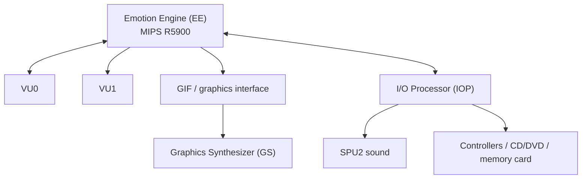

# 01 · PlayStation 2 Hardware Architecture

[← Start here](00-start-here.md) · [Next: Disc structure →](02-disc-and-formats.md)

> **Goal:** Recognize each PS2-specific subsystem so it can be studied, isolated and eventually replaced or emulated appropriately.

## High-level system map



This diagram summarizes roles rather than the full interconnect topology or DMA protocols.

## Emotion Engine: EE

The PS2's main CPU is based on the MIPS R5900 and uses architecture-specific instructions, execution behavior and memory conventions. A game typically starts through an EE executable, often in ELF form.

Reverse engineers need to recognize:

- **Calling conventions:** function parameters, return registers and stack frames.
- **Branch delay slots:** instruction scheduling can affect disassembly and translation.
- **Endianness:** PS2 EE data is little-endian; Xbox 360 PowerPC is generally big-endian in typical native environments.
- **DMA:** data movement to graphics and other units may be assembled as command chains.
- **Scratchpad and special registers:** memory addresses and direct hardware accesses are not portable.
- **Interrupt-driven logic:** frame and asynchronous service timing require new abstractions.

Decompiled pseudocode is not original source. Validate inferred types, function signatures and pointer semantics.

## VU0 and VU1: vector units

VU programs perform transforms, animation, lighting and other math-heavy tasks. Some games upload custom VU microcode. This code will not run on the Xbox 360 Xenon CPU.

For a port, identify **what the routine computes**, its input layout, output layout and numeric tolerances. Reimplement equivalent math in portable C++ first, then optimize for the Xbox 360's supported vector instructions as needed.

Watch for matrix orientation, handedness, fixed-point conversion, normal vectors and animation skinning.

## Graphics Synthesizer: GS

The PS2 GS consumes graphics command streams and manages framebuffer/depth behavior, blending, texture lookups and various pixel operations. A native Xbox 360 game cannot pass GS packets directly to Xenos.

Porting implications include:

- Rebuilding draw submission and resource upload.
- Mapping GS blending, alpha and depth behavior to shaders and Xenos states.
- Handling palette/CLUT textures and texture layout.
- Reproducing visually important framebuffer effects and multi-pass techniques.
- Measuring differences with controlled reference captures.

## IOP and IRX modules

The I/O Processor runs separate code and services, often loaded as `.IRX` modules. The EE program can communicate with IOP services over RPC-like interfaces. These may drive input, storage, networking or audio.

In a native port, it is usually better to define a portable *service contract*:

```cpp
struct PadState { unsigned buttons; float leftX, leftY; };
PadState readController(unsigned port);
bool readAsset(const char* name, void* out, unsigned length);
```

These are illustrative APIs, not actual PS2 or XSDK functions. The Xbox 360 backend supplies its own implementations.

## SPU2 audio

Sound engines rely on particular sample encodings, mixing behavior, streaming formats, voices and loop settings. Keep **audio data**, **playback control** and **hardware output** separate.

A new backend needs correct output format, timing, channel mixing and buffer scheduling. Converting a sound file does not recreate the original logic for events, volume fades or positional playback.

## The memory trap

Although Xbox 360 has more general-purpose memory than PS2, the original game may rely on:

- Fixed physical addresses and pointer casts.
- Packed structs and PS2-specific alignment.
- Scratchpad and DMA-visible memory.
- Local texture storage and circular streaming pools.
- Race conditions hidden by original timing.

A larger memory pool does not automatically solve incompatible layouts or APIs.

## Investigation checklist

| Indicator | Likely action |
|---|---|
| VU microprograms | Reimplement math / rendering support |
| GS register writes | New renderer |
| IOP service calls | New OS/service adapter |
| Hard-coded EE addresses | Memory refactoring |
| CD/DVD seek behavior | Streaming and filesystem layer |
| Frame-dependent simulation | Timing equivalence tests |
| SPU2 calls | Audio backend replacement |

See [PS2SDK](https://github.com/ps2dev/ps2sdk) and [the reference index](14-references.md) for public development documentation.
