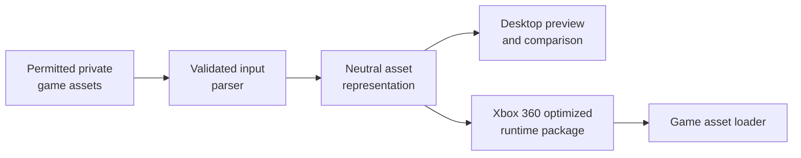

# 05 · Asset Conversion Pipeline

[← Code reconstruction](04-code-reconstruction.md) · [Next: Xbox 360 architecture →](06-xbox360-architecture.md)

> **Goal:** Separate original file storage from platform-neutral runtime data, with verifiable conversion and legal boundaries.

## Reuse versus rewrite

Not every PS2 data file must be manually rewritten. A resource may contain models, animation curves, image data, compressed sound or cutscene video. The new runtime can sometimes read it after implementing the correct parser, but other formats need an offline conversion pipeline.



**Important:** the public repository should contain only independently authored format descriptions, tools and synthetic fixtures. Do not distribute commercial resources unless you have the necessary rights.

## Models and geometry

Identify the position, normal, color, UV, weight, bone and index streams. Check whether an object uses triangle lists, strips or custom VU/GS-friendly layouts.

| Source concern | Porting action |
|---|---|
| Compressed or quantized positions | Decode scale and offset before conversion |
| Custom coordinate handedness | Apply documented coordinate transformation |
| Triangle strips | Preserve winding; optionally convert to triangle lists |
| Interleaved vertex streams | Define a neutral vertex format |
| Skeleton/bone data | Recover hierarchy and bind pose |
| Custom animation sampling | Reproduce frame interpolation and event timing |

Validation: compare mesh silhouettes, bounding boxes, normals, UV alignment and skeleton poses against a reference scene. Export a single object before implementing an entire world renderer.

## Textures and materials

PS2 games can store CLUT/paletted textures, swizzled pixel layouts, custom alpha channels, mipmaps and texture states in separate tables.

Processing checklist:

1. Read dimensions, pixel format and palette definitions.
2. Decode/de-swizzle into a known intermediate image.
3. Preserve alpha semantics (PS2 alpha conventions may not map trivially).
4. Record wrapping, filtering, blend mode and material metadata.
5. Generate texture data in a format supported by the target runtime.
6. Compare transparent edges, lighting and interpolation using reference captures.

A PNG export can retain pixels but discard blend flags. Keep material state in a separate manifest.

## Audio data and playback

Distinguish **archive format**, **codec** and **event system**. For example, AFS is often a container, while VAG can contain ADPCM samples.

Record:

- Audio sample rate and channel count.
- Codec, loop start/end positions, silence and alignment.
- Streaming chunk boundaries and prefetch behavior.
- Music transitions, event IDs, volume, pitch and pan.
- Buffering and latency under real gameplay loads.

Even correctly converted audio will sound wrong if event timing or loops change.

## Video and cutscenes

PS2 PSS may multiplex video and audio data. The Xbox 360 needs an appropriate decoder or permitted converted assets. Preserve cutscene duration, game-state transitions, dialogue timing and subtitle triggers. Some content pipelines are legally restricted; always check rights before conversion or distribution.

## Safe binary parser design

Binary inputs should never be trusted blindly. Use defensive validation:

```text
if offset > file_size:
    reject("entry begins outside the file")
if length > file_size - offset:
    reject("entry exceeds file boundary")
if entry_count > known_safe_limit:
    reject("suspicious entry count")
```

Also validate magic values, format versions, integer overflow, compression sizes, alignment and memory limits. Test the parser on malformed synthetic inputs.

## Proposed manifest format

The following is **new, illustrative metadata**, not a format used by any named game:

```json
{
  "assetVersion": 1,
  "sourceName": "demo_mesh_01",
  "coordinateSystem": "documented-per-project",
  "mesh": "demo_mesh_01.mesh",
  "materials": ["demo_material_01"],
  "verified": false
}
```

The actual runtime package can use a compact binary representation, but keep the conversion recipe and original data schema documented.

## Milestone completion checklist

- [ ] Reproducible parser and strict validation.
- [ ] One sample mesh renders in a desktop viewer.
- [ ] One texture retains color, alpha and UV correctness.
- [ ] One sound plays without corrupted pitch or loop.
- [ ] Generated assets have deterministic hashes.
- [ ] No copyrighted source data is committed.

[Next: Xbox 360 hardware →](06-xbox360-architecture.md)
