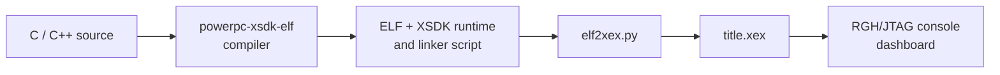

# 08 · Build an Xbox 360 XEX with XSDK

[← Subsystem porting](07-platform-porting.md) · [Next: Validation →](09-testing.md)

> **Goal:** Validate the native PowerPC/XEX development environment using an independently built sample. **This does not compile a PS2 game by itself.**

**Software prerequisites and optional libraries:** [Essential Tool Directory](15-toolbox.md#stage-e--build-and-test-a-native-xbox-360-application) · [Guided XEX workflow](16-practical-workflows.md#workflow-5--build-a-native-xbox-360-xex).

## Why XSDK?

[XSDK](https://github.com/xenosworks/xsdk) is an independent Xbox 360 homebrew SDK that targets the retail kernel on RGH/JTAG consoles. Its documented workflow compiles PowerPC code, links against its own runtime/library and packages the output into XEX2 using `tools/elf2xex.py`.

This guide follows XSDK's public [Getting Started instructions](https://github.com/xenosworks/xsdk/blob/main/docs/GETTING_STARTED.md), as read in November 2026. Follow the upstream instructions if they change.

> [!CAUTION]
> Use only legally obtained tools and independently distributed SDKs. Do not include proprietary Microsoft XDK binaries, leaked headers, secrets or console keys. A retail, unmodified Xbox 360 normally cannot launch unsigned homebrew XEX files.

## Prerequisites

- Windows 10/11 with WSL 2 Debian, or a Linux development machine.
- Debian-compatible packages, approximately 10 GB free for toolchain build work.
- Git, CMake **3.25+**, Python **3.11+**, compiler build dependencies.
- Xbox 360 RGH/JTAG hardware that can launch unsigned XEX homebrew.
- A means of transferring files such as the dashboard's configured FTP server.

## Step 1 — Prepare Debian/WSL

On Windows, from PowerShell:

```powershell
wsl --install -d Debian
```

Inside Debian (WSL or native Linux):

```bash
sudo apt update
sudo apt install build-essential bison flex texinfo libgmp-dev \
  libmpfr-dev libmpc-dev curl xz-utils patch python3 \
  cmake ninja-build git
```

Ensure your installed versions satisfy XSDK's requirements. Keep the toolchain in the Linux filesystem rather than `/mnt/c` when working under WSL for better build performance.

## Step 2 — Get XSDK

```bash
git clone https://github.com/xenosworks/xsdk.git ~/xsdk
cd ~/xsdk
```

Review upstream `README.md` and `docs/GETTING_STARTED.md` before continuing.

## Step 3 — Build the PowerPC toolchain

According to XSDK's documentation, this builds its own `powerpc-xsdk-elf` GCC/binutils/newlib toolchain:

```bash
cd ~/xsdk
PREFIX=$HOME/xsdk-gcc WORK=$HOME/xsdk-gcc-work \
  JOBS=$(nproc) tools/toolchain/build.sh
~/xsdk-gcc/bin/powerpc-xsdk-elf-gcc --version
```

The script downloads source packages and verifies checksums. If a stage fails, read its build log in the work directory and fix the underlying dependency or compatibility issue before retrying.

## Step 4 — Shader tools

The current XSDK workflow documents a companion `glslang-xenon` build for Xenos shaders. For GPU-related samples, follow **Step 4 in [upstream Getting Started](https://github.com/xenosworks/xsdk/blob/main/docs/GETTING_STARTED.md)** to build and install the expected shader compiler. Do not skip that step for shader-dependent applications.

## Step 5 — Build XSDK and samples

```bash
cd ~/xsdk
make -j$(nproc)
make samples
```

Upstream XSDK documents outputs including:

- `build/libxsdk.a` — the SDK library.
- `build/xsdk_test.xex` — a test title.
- `build/samples/hello/hello.xex` — controller / display / logging sample.
- `build/samples/triangle/triangle.xex` — basic shader and rendering sample.
- `build/samples/template/title.xex` — minimal custom title template.

Start by confirming `hello.xex` and `template/title.xex` work on your own hardware.

## Step 6 — Build a separate title from the template

```bash
cp -r ~/xsdk/samples/template ~/mytitle
cd ~/mytitle
cmake -S . -B build -G Ninja \
  -DCMAKE_TOOLCHAIN_FILE=$HOME/xsdk/cmake/xsdk.cmake \
  -DXSDK_TOOLCHAIN=$HOME/xsdk-gcc \
  -DCMAKE_BUILD_TYPE=RelWithDebInfo
cmake --build build
```

The XSDK template declares an executable and calls `xsdk_add_xex(title)` in its CMakeLists. The expected output is `build/title.xex`. Replace template code incrementally, with your **independently authored** portable game modules and Xbox 360 backend.

## How the compilation pipeline works



A PS2 `.ELF` is **not** interchangeable with the Xbox-targeted ELF. The SDK's packager needs an ELF compiled and linked for the correct PowerPC ABI and XSDK environment.

## Step 7 — Deploy and test

Use your console's authorized FTP setup or another supported transfer method to copy `title.xex` into its own folder (for example, `Hdd1:/Homebrew/MyTitle/`). Launch it through an RGH/JTAG-compatible dashboard such as Aurora.

Read the application's log file next to the XEX if it was generated. XSDK documents logs named after the title: `title.xex` → `title.log`. Test the original sample before integrating custom code.

## Optional: Xenia smoke test

Xenia may help identify obvious startup errors on a PC, but XSDK documentation warns that Xenia differs from real Xbox 360 hardware in API and instruction handling. **Real hardware is the final authority.** Do not use a successful emulator launch as proof of console compatibility.

## Frequent build pitfalls

| Symptom | Possible issue | Next check |
|---|---|---|
| Compiler missing | Toolchain not installed / bad prefix | Verify `powerpc-xsdk-elf-gcc --version` |
| CMake toolchain not found | Wrong path or stale build directory | Correct `CMAKE_TOOLCHAIN_FILE`; reconfigure |
| Shader compilation fails | Missing/incompatible glslang-xenon | Follow upstream shader setup |
| XEX launches then exits | API initialization or title error | Inspect `title.log` |
| Render works on PC only | Target backend issue | Validate real Xenos resource and presentation steps |
| Game assets fail to load | Paths, byte order or missing data | Log resource identifiers, sizes and read errors |

**Next:** [Testing and validation](09-testing.md) and [current upstream instructions](https://github.com/xenosworks/xsdk/blob/main/docs/GETTING_STARTED.md).
