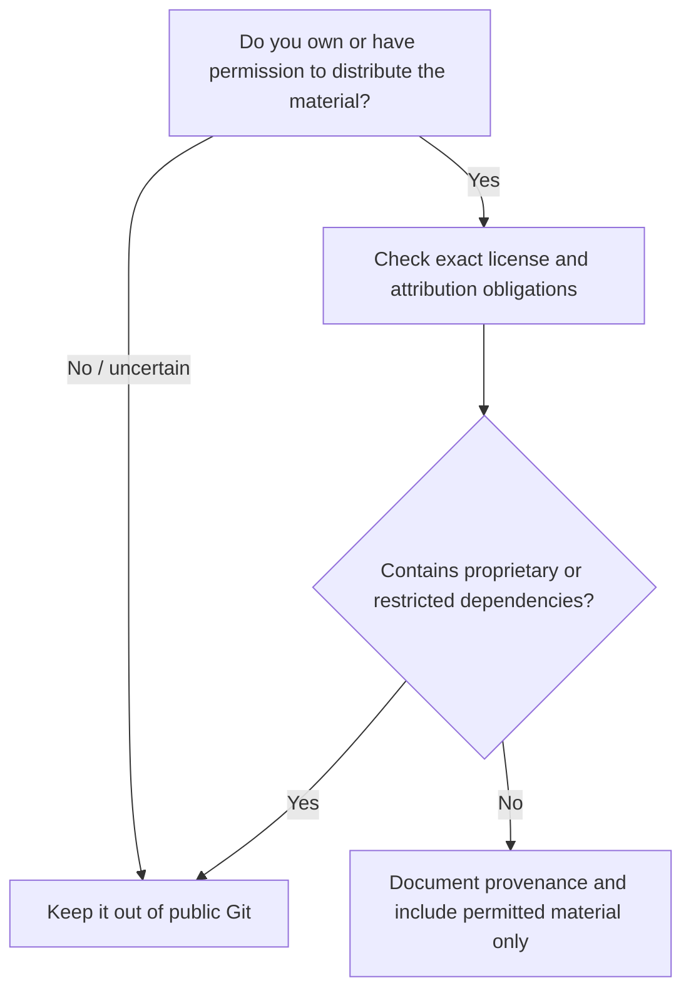

# 11 · Legal and Ethical Research

[← Roadmap](10-roadmap.md) · [Next: Troubleshooting →](12-troubleshooting.md)

> **Goal:** Understand the difference between technical capability and permission to inspect, modify, publish or distribute code and assets.

**This document is general educational information, not legal advice.** Copyright, interoperability exceptions, anti-circumvention rules and licensing vary by jurisdiction. Consult a qualified lawyer for a particular project or planned release.

## What may be protected?

A game can contain many separately protected elements: executable code, graphics, models, animations, music, voice performances, videos, trademarks, scripts and tools. Rights in one part do not automatically cover others.

Possessing a game disc does **not** automatically grant permission to redistribute extracted assets, executable binaries or a modified copy. Similarly, publishing decompiler output can create legal issues even if it is technically possible to generate it.

## Safer approaches

- Start with original code and art that you created.
- Use game or homebrew source with explicit compatible licensing.
- Study public hardware documentation and open-source SDKs.
- Keep permitted research copies private and document their provenance.
- Publish your own tools, neutral file-format descriptions and synthetic test fixtures.
- For commercial compatibility research, document behavior rather than uploading copyrighted software.
- Use clean-room implementation practices when appropriate and legally advised.

## Never include these in this repository

- Commercial PS2 ISO images, executable game files or content archives.
- Console firmware, PS2 BIOS dumps, Xbox 360 keys or credentials.
- Leaked or proprietary Microsoft or Sony SDK files.
- Decompiled copyrighted source material without an applicable license or authorization.
- Music, models, textures, voice, video or other game content without distribution rights.
- Personal information captured in debugging logs.

## Practical contribution decision tree

## What about a patch?

A patch that transforms user-provided legitimate content may sometimes be different from distributing entire commercial files, but it is **not inherently legal in every jurisdiction** and its contents can still be copyrighted. Seek legal review before releasing copyrighted binary deltas or bypass-related material.

## Trademarks and affiliation

This project is independently authored and is not affiliated with or endorsed by Sony Interactive Entertainment, PlayStation, Microsoft or Xbox. Product names are used solely to identify technical platforms.

## License of this repository

The **documentation and independently authored code in this repository** are governed by the root [Apache-2.0 license](../LICENSE), to the extent their authors have the rights to license them. This license does **not** grant rights to external games, SDKs, console firmware or third-party assets.

[Next: Troubleshooting →](12-troubleshooting.md)
