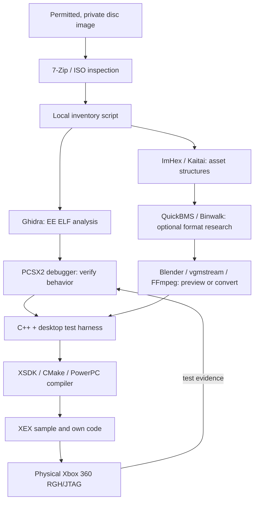

# 15 · Essential Software and Tool Directory

[← Reference library](14-references.md) · [Next: Hands-on workflows →](16-practical-workflows.md) · [↑ Documentation home](../README.md)

> **Goal:** Install only the programs needed for the current research stage, understand what each tool actually does, and produce a testable artifact before moving to the next stage.

**This directory is a curated set of independently maintained tools, not a preconfigured PS2-to-Xbox 360 converter.** Supported formats, operating systems and commands can change; follow the upstream documentation linked for each program. **No listed tool alone can convert an arbitrary PS2 game ISO into a working Xbox 360 XEX.**

## Start with the small toolkit

You do **not** need every program on this page. On a Windows 10/11 PC, a sensible beginning is:

| Priority | Program | What you do with it | Official source |
|:--:|:--|:--|:--|
| **1** | **7-Zip** | Inspect the files on a permitted disc image (if supported), or archives already extracted | [7-zip.org](https://www.7-zip.org/) |
| **1** | **PCSX2** | Observe reference gameplay; inspect code and memory with its advanced debugger | [pcsx2.net](https://pcsx2.net/) / [debugger docs](https://pcsx2.net/docs/advanced/debugger/) |
| **1** | **Ghidra** | Inspect PS2 ELF code, data, functions and MIPS assembly | [ghidra-sre.org](https://ghidra-sre.org/) |
| **1** | **ImHex** | Read binary headers, identify fields and write byte-layout patterns | [ImHex](https://github.com/WerWolv/ImHex) |
| **1** | **Python 3.11+** | Automate file metadata inventories and build isolated parser tests | [python.org](https://www.python.org/) |
| **2** | **Git + editor** | Track independently written research notes and C/C++ code | [Git](https://git-scm.com/) / [VS Code](https://code.visualstudio.com/) |
| **2** | **WSL 2 / Debian** | Provide a Linux environment for the current XSDK toolchain | [Microsoft WSL](https://learn.microsoft.com/windows/wsl/install) |
| **2** | **CMake + Ninja** | Configure and compile desktop and XSDK example projects | [CMake](https://cmake.org/) / [Ninja](https://ninja-build.org/) |
| **2** | **XSDK** | Build PowerPC-native Xbox 360 homebrew and package an XEX | [xenosworks/xsdk](https://github.com/xenosworks/xsdk) |

**Priority 1** is for understanding the source. **Priority 2** is for building a new target program. Extra tools below are conditional.

## Workflow map: which program solves which problem?



### Stage A · Identify the disc and the boot executable

| Tool | Use it for | Output | Limitations |
|:--|:--|:--|:--|
| [7-Zip](https://www.7-zip.org/) | Open supported ISO/archive filesystem contents | File list, extracted private files | Some games/partitions need other readers; it does not reverse engineer code |
| [Python](https://www.python.org/) + [our inventory script](../tools/disc_inventory.py) | Enumerate an **already-extracted directory** | Paths, sizes, SHA-256, candidate boot path | **Does not open an ISO** and never decompiles anything |
| [ImHex](https://github.com/WerWolv/ImHex) | Examine ELF magic and arbitrary file header bytes | Format hypotheses and field tables | Not an automatic format decoder |
| [GNU binutils readelf/objdump](https://sourceware.org/binutils/docs/) | Examine ELF metadata and disassemble with an **appropriate MIPS-target build** | Sections, symbol tables, assembly | Host binutils may not support the target; cannot recompile game |
| [PS2SDK](https://github.com/ps2dev/ps2sdk) | Study public PS2 programming interfaces and modules | API knowledge and PS2 homebrew samples | Does not expose proprietary game source |

**First checkpoint:** identify the actual `SYSTEM.CNF` boot target, record the revision and a reproducible inventory. See [Chapter 02](02-disc-and-formats.md).

### Stage B · Understand the executable and runtime behavior

| Tool | What it helps with | Important caveat |
|:--|:--|:--|
| **[Ghidra](https://ghidra-sre.org/)** | Load a compatible PS2 ELF, analyze MIPS instructions, xrefs, call graphs, data types and decompiler pseudocode | Decompiled C-like code is not original source; manual reconstruction is unavoidable |
| **[PCSX2 Debugger](https://pcsx2.net/docs/advanced/debugger/)** | Inspect and debug R5900 (EE) and R3000 (IOP) state and compare game behavior | Emulator observations may differ from physical PS2 |
| **[Cutter](https://cutter.re/)** (optional) | Alternative graphical disassembly and cross-reference exploration backed by Rizin | Not a PS2 game porting tool |
| **[Rizin](https://github.com/rizinorg/rizin)** (optional) | Scriptable binary exploration and batch analysis | Requires learning its CLI and architecture settings |
| **[Splat](https://github.com/ethteck/splat)** (specialized) | Organize compatible binary segments and reverse-engineering projects | Game-specific config; do not assume every PS2 executable is supported |

**PCSX2 debugger location:** in PCSX2, enable **Tools → Show Advanced Settings**, then select **Debug → Open Debugger**, as described by [the official debugger guide](https://pcsx2.net/docs/advanced/debugger/). The **R5900** view is for the main EE CPU, while **R3000** is for the IOP. Use a legally obtained BIOS where required by the emulator.

**Ghidra first session:** import your private main executable, verify its architecture and loading options, run analysis, inspect strings and cross-references, then annotate probable startup, update and loading functions. Export your *own analysis notes*, not copyrighted game executable contents.

**Checkpoint:** obtain **one specific behavior contract** with repeatable reference tests. See [Chapter 03](03-reverse-engineering.md).

### Stage C · Figure out proprietary archives and assets

| Tool | Best use | Specific caution |
|:--|:--|:--|
| **[ImHex](https://github.com/WerWolv/ImHex)** | Hex view and Pattern Language descriptions of unknown headers, offsets, counts and fields | Pattern guesses still require validation |
| **[Kaitai Struct](https://kaitai.io/)** / [Web IDE](https://ide.kaitai.io/) | Express discovered binary structure in `.ksy`, visualize records and generate parser code | Only works after the format is sufficiently understood; generated parsers still need bounds tests |
| **[QuickBMS](https://aluigi.altervista.org/quickbms.htm)** (optional) | Script-based extraction from a **known, supported** game archive format | Requires a trusted, matching BMS script; scripts can have risky behavior and do not magically handle all games |
| **[Binwalk](https://github.com/ReFirmLabs/binwalk)** (optional) | Find embedded known signatures and high-entropy regions in unknown blobs | Primarily a firmware tool; signatures can be false positives; PS2 custom archives often need manual analysis |
| **[Blender](https://www.blender.org/)** | View/repair **converted** meshes and animations | Does not automatically understand a game's native PS2 model format |
| **[vgmstream](https://github.com/vgmstream/vgmstream)** | Decode and inspect **supported** video-game audio streams and loop metadata | A decoder, **not** an encoder and not universal across game audio formats |
| **[FFmpeg / ffprobe](https://ffmpeg.org/)** | Inspect or transcode recognized audio/video streams | Supported demuxers/codecs vary; not every PS2 `.PSS` or proprietary stream will open |

For new formats, use **ImHex → documented fields → Kaitai or a defensive custom parser → synthetic unit tests → desktop preview**. QuickBMS is useful only when you know the archive specification and trust the script. Never enable risky features in unreviewed third-party scripts.

Examples to probe files without assuming success:

```bash
binwalk "private-research/unknown_archive.bin"
ffprobe -hide_banner "private-research/unknown_video.pss"
```

If a tool reports “unknown format,” that is **not proof** that the file is damaged. It may use a title-specific layout or codec. See [Chapter 05](05-asset-pipeline.md).

### Stage D · Rebuild portable C/C++ code

| Tool | Role |
|:--|:--|
| [VS Code](https://code.visualstudio.com/) or another editor | Source navigation, C++ development and debugging |
| [Git](https://git-scm.com/) | Track code changes and comparison experiments |
| [CMake](https://cmake.org/) + [Ninja](https://ninja-build.org/) | Portable builds and test targets |
| [Clang](https://clang.llvm.org/) or [GCC](https://gcc.gnu.org/) | Compile your **new desktop implementation** and enable warnings/sanitizers where supported |
| [Python](https://www.python.org/) | Write parsers, generate synthetic test data and compare expected output |

Start with a single portable module: input → game update → output state. Use a desktop executable to debug without waiting for console cycles. **Compiling with a PC C++ compiler does not create an Xbox 360 binary.**

### Stage E · Build and test a native Xbox 360 application

| Tool | Role | Restrictions |
|:--|:--|:--|
| **[XSDK](https://github.com/xenosworks/xsdk)** | Independent PowerPC toolchain, native Xbox 360 APIs, GPU/audio support and XEX packager | Homebrew on compatible **RGH/JTAG** consoles; read upstream docs |
| **[XSDK Getting Started](https://github.com/xenosworks/xsdk/blob/main/docs/GETTING_STARTED.md)** | Exact current toolchain setup, build commands and sample title outputs | Use current upstream commands rather than old copied tutorials |
| [glslang-xenon](https://github.com/xenosworks/glslang-xenon) | Shader front end used by XSDK's documented shader toolchain | Follow XSDK's version and build requirements |
| [SDL-xenon](https://github.com/xenosworks/SDL-xenon) (optional) | SDL-based portability layer adapted for XSDK | Check current supported features and setup; it does not replace game reconstruction |
| [FAudio-xenon](https://github.com/xenosworks/FAudio-xenon) (optional) | Alternative audio integration route for some XSDK applications | Must be integrated and validated per library docs |
| [Xenia](https://github.com/xenia-project/xenia) (optional) | Preliminary desktop smoke test of an Xbox 360 title | A successful test **does not guarantee** real-console compatibility |
| FTP client ([FileZilla](https://filezilla-project.org/) or CLI `curl`) | Transfer your own `.xex` and permitted assets to a dashboard-managed folder | FTP may transmit credentials without encryption: use a trusted local network only |
| Xbox 360 **RGH/JTAG hardware** | Final execution environment | Physical testing is required to claim success |

**Critical distinction:** [LibXenon](https://github.com/Free60Project/libxenon) is an alternative XeLL/bare-metal-oriented ecosystem; this project's [Chapter 08](08-build-and-xex.md) uses **XSDK / retail-kernel XEX**, not a LibXenon ELF boot workflow.

## Environment readiness checks

From the root of this repository:

```bash
python tools/check_environment.py
```

The command checks whether key **command-line executables are on PATH** and prints links/instructions for any missing entries. GUI applications like PCSX2, Ghidra or ImHex may be installed even if their executable is not on PATH; the script **cannot certify their absence or functionality**.

To inspect an **already extracted, legally held** disc folder and generate a **private** machine-readable inventory:

```bash
python tools/disc_inventory.py "/path/to/extracted-disc" --sha256 > "/path/to/private-inventory.json"
```

The script is read-only and never uploads data, disassembles executables, or bundles copyrighted content. **Keep the generated inventory private**, as paths and identifiers may reveal information about your disc version.

## Tool choice by immediate question

| You want to know… | Start with… | Then… |
|:--|:--|:--|
| “Which executable boots?” | 7-Zip + `SYSTEM.CNF` + inventory script | ELF header inspection in ImHex |
| “What does this MIPS function do?” | Ghidra | PCSX2 debugger + reproducible experiment |
| “What is inside this `.DAT`?” | ImHex | Kaitai Struct / custom parser; QuickBMS only if format is known |
| “Can I view a mesh?” | Custom parser / converted mesh | Blender |
| “What codec is the audio?” | vgmstream / ffprobe | Codec verification and converted playback test |
| “How do I build an XEX?” | XSDK Getting Started | XSDK sample → real console |
| “Why does my title crash?” | XSDK logs and minimal sample | Chapter 12 + hardware tests |

## Trust, legality and licensing

- Download programs from their **official sites or source repositories**, verify releases, and avoid untrusted bundles.
- Treat BMS scripts, plugins, parsers and downloadable executables as potentially untrusted; scan/review and run them in a restricted environment when appropriate.
- Use only legally held binaries and permitted assets, and **never upload proprietary code or game content** to public web tools, issue trackers or Git commits.
- Every listed tool has its **own license**. Using it does not give you rights to redistribute commercial game content.
- The project deliberately does not provide BIOS files, console keys, leaked SDKs or commercial disc downloads.

## Next step

Continue with [Chapter 16: Practical Workflows](16-practical-workflows.md), which shows where each tool fits in an actual small experiment. If you are building an XEX, follow [Chapter 08](08-build-and-xex.md) alongside the latest upstream XSDK instructions.
